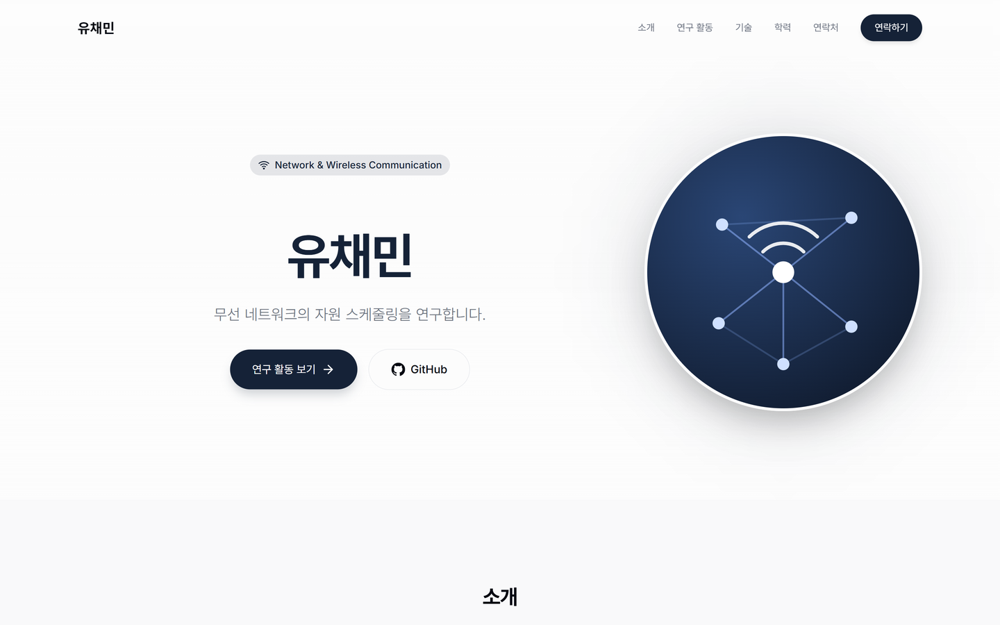
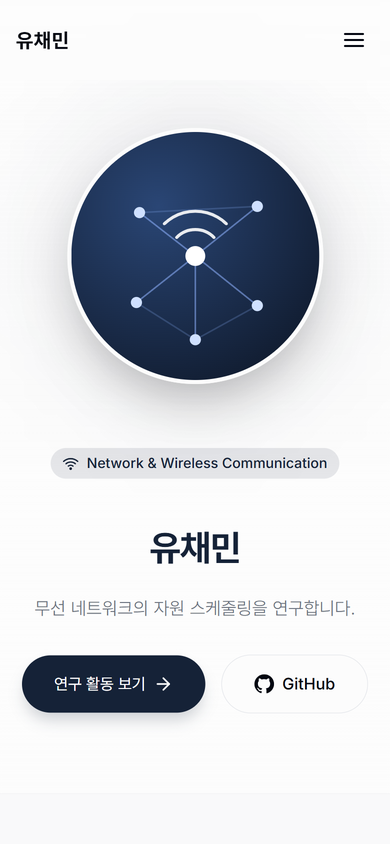

# 유채민 포트폴리오 (proj_portfolio)

무선 네트워크의 자원 스케줄링을 연구하는 학부연구생 유채민의 개인 소개 사이트입니다.
2026학년도 초급프로젝트 과제 1로 Hugo 테마를 골라 직접 설정하고, GitHub Actions로 GitHub Pages에 배포합니다.

- 공개 사이트: https://dbchim0418-yu.github.io/proj_portfolio/
- 저장소: https://github.com/dbchim0418-YU/proj_portfolio
- 사용 테마: [Kiyomi Portfolio](https://github.com/mathscantor/hugo-theme-kiyomi-portfolio) (MIT 라이선스)
- 원본 테마의 영문 안내는 [site/themes/template/README.md](site/themes/template/README.md)에 그대로 남겨 두었습니다.

## 화면

| 데스크톱 (1440px) | 모바일 (390px) |
| --- | --- |
|  |  |

2026-11-04 15:28 KST, Microsoft Edge 156 개발자 도구의 반응형 모드로 공개 사이트를 캡처했습니다. 동작 확인 결과는 [docs/VERIFICATION.md](docs/VERIFICATION.md)에 정리했습니다.

## 사용 도구와 버전

| 도구 | 버전 | 사용 위치 |
| --- | --- | --- |
| Hugo (extended) | 0.167.0 | 사이트 빌드 (`.github/workflows/hugo-pages.yml`에서 지정) |
| Dart Sass | 1.105.0 | 테마 스타일 처리 (워크플로가 자동 설치) |
| Python | 3.12 (Actions), 3.12.10 (작성자 PC) | 수업 제공 준비, 빌드 스크립트 실행 |
| Node.js | 24 | 워크플로의 의존성 준비 단계 (이 테마는 npm 패키지를 쓰지 않음) |
| Git | 2.x | 버전 관리, GitHub에 push |
| 준비 스크립트 | `prepare_github_pages.py` 3.1 | 수업 제공 스크립트. 테마 ZIP을 `site/`로 정리하고 배포 워크플로 생성 |

## 폴더 구조

```text
proj_portfolio/
├─ .github/
│  ├─ workflows/hugo-pages.yml   # main에 push하면 빌드 후 GitHub Pages에 배포
│  └─ pages_build.py             # 워크플로가 실행하는 빌드 스크립트 (준비 스크립트 사본)
├─ site/                         # 실제로 빌드되는 Hugo 사이트
│  ├─ hugo.toml                  # 사이트 설정 (이름, 소개 문구, GitHub 주소 등)
│  ├─ pages.json                 # 배포 주소(baseURL)와 테마 설정 (준비 스크립트가 생성)
│  ├─ content/_index.md          # 소개 섹션 본문
│  ├─ data/                      # 연구 활동, 기술, 학력 내용 (YAML)
│  ├─ layouts/                   # 테마 템플릿을 덮어쓴 파일 (한국어화, 기능 수정)
│  ├─ assets/                    # 사이트 전용 CSS, JS
│  ├─ static/                    # 아바타 이미지, Pretendard 글꼴
│  └─ themes/template/           # Kiyomi Portfolio 테마 원본 (수정하지 않음)
├─ prepare_github_pages.py       # 수업 제공 준비 스크립트
└─ (그 밖의 폴더)                 # 테마 ZIP을 풀었을 때 있던 원본 파일
```

## 설치와 로컬에서 확인하기

1. **Hugo extended 0.167.0 설치**
   - [Hugo 릴리스 페이지](https://github.com/gohugoio/hugo/releases/tag/v0.167.0)에서 `hugo_extended_0.167.0_windows-amd64.zip`을 받아 압축을 풀고, `hugo.exe`가 있는 폴더를 PATH에 추가합니다.
   - 설치 확인: `hugo version` 결과에 `v0.167.0`과 `extended`가 보여야 합니다.
2. **저장소 받기**
   ```bash
   git clone https://github.com/dbchim0418-YU/proj_portfolio.git
   cd proj_portfolio
   ```
3. **미리보기 서버 실행** (저장하면 자동으로 새로고침됩니다)
   ```bash
   hugo server -s site --config hugo.toml,pages.json
   ```
   브라우저에서 http://localhost:1313/proj_portfolio/ 을 엽니다. 종료는 `Ctrl + C`입니다.
4. **배포와 같은 방식으로 빌드하기** (선택)
   ```bash
   python .github/pages_build.py --build
   ```
   결과는 `public/` 폴더에 만들어지며, `.gitignore`에 들어 있어 커밋되지 않습니다.

## 내용을 고칠 때 수정할 파일

| 바꾸고 싶은 내용 | 파일 |
| --- | --- |
| 이름, 첫 화면 소개 문구, 분야 표시, GitHub 주소, 아바타 | `site/hugo.toml`의 `[params]` |
| 소개 섹션 (관심 분야, 학습 목표) | `site/content/_index.md` |
| 연구 활동, 그 밖의 활동 | `site/data/experience.yaml` |
| 기술과 사용 사례 | `site/data/skills.yaml` |
| 학력 | `site/data/education.yaml` |
| 섹션 구성, 문구, 메뉴 | `site/layouts/` 아래 파일 (테마 원본을 복사해 수정한 파일) |
| 색, 글꼴, 간격 같은 스타일 | `site/assets/css/custom.css` |
| 메뉴 이동, 뒤로 가기, 모바일 메뉴 동작 | `site/assets/js/nav.js` |
| 아바타 그림, 글꼴 파일 | `site/static/images/`, `site/static/fonts/` |

`site/themes/template/` 안의 테마 원본은 직접 고치지 않습니다. 바꾸고 싶은 템플릿은 같은 경로로 `site/layouts/`에 복사해서 고치면 Hugo가 복사본을 우선 사용합니다.

## 수정 후 다시 배포하기

1. 파일을 고친 뒤 미리보기 서버(`hugo server -s site --config hugo.toml,pages.json`)로 화면을 확인합니다.
2. 바뀐 파일만 골라 커밋하고 main에 push합니다.
   ```bash
   git add site/data/experience.yaml
   git commit -m "content: 연구 활동 내용 수정"
   git push
   ```
3. 저장소의 **Actions** 탭에서 `Deploy Hugo to GitHub Pages` 실행이 자동으로 시작되었는지 확인합니다. build와 deploy가 모두 초록 체크가 되면 배포가 끝난 것입니다.
4. 공개 사이트(https://dbchim0418-yu.github.io/proj_portfolio/)를 `Ctrl + F5`로 새로고침해 바뀐 내용을 확인합니다.
5. 실행이 실패하면 실패한 단계를 눌러 오류 줄을 확인하고, 고친 뒤 다시 push합니다. 처음 저장소를 만들 때는 **Settings → Pages → Source**를 **GitHub Actions**로 설정해야 합니다.

## 출처와 라이선스

| 자료 | 사용 위치 | 구분 | 출처 | 이용 조건 |
| --- | --- | --- | --- | --- |
| Kiyomi Portfolio 테마 | 사이트 전체 레이아웃, 스타일, 스크립트 (`site/themes/template/`) | 외부 자료 | https://github.com/mathscantor/hugo-theme-kiyomi-portfolio | MIT 라이선스. 원문은 [LICENSE](LICENSE), [site/themes/template/LICENSE](site/themes/template/LICENSE) |
| 테마 템플릿 수정본 | `site/layouts/`, `site/assets/js/nav.js` | 외부 자료를 직접 수정 | 위 테마 원본 | MIT 라이선스를 따름 |
| Pretendard 1.3.9 글꼴 (경량판) | 한글 글꼴 (`site/static/fonts/pretendard/`) | 외부 자료 | https://github.com/orioncactus/pretendard | SIL Open Font License 1.1. 원문은 [LICENSE.txt](site/static/fonts/pretendard/LICENSE.txt) |
| Inter, Playfair Display 글꼴 | 영문 본문, 제목 (테마가 Google Fonts에서 불러옴) | 외부 자료 | https://fonts.google.com | SIL Open Font License 1.1 |
| 준비 스크립트 `prepare_github_pages.py`, `.github/` | 배포 준비와 GitHub Actions 빌드 | 수업 제공 자료 | 2026학년도 초급프로젝트 | 수업 안내에 따름 |
| 아바타 그림 `avatar.svg` | 첫 화면 프로필 이미지, 파비콘 | 직접 제작 (AI 도구로 SVG 작성 후 본인이 선택, 수정) | 이 저장소 | 별도 조건 없음 |
| 소개, 연구 활동, 기술 문구 | `site/content/`, `site/data/` | 직접 작성 (AI 도구로 문장 다듬기) | 이 저장소 | 별도 조건 없음 |
| `site/assets/css/custom.css`, 404 페이지 | 사이트 전용 스타일, 오류 페이지 | 직접 작성 (AI 도구 보조) | 이 저장소 | 별도 조건 없음 |

AI 도구는 문구 다듬기, 템플릿 수정 코드 작성, 동작 시험에 사용했으며, 모든 반영 내용은 본인이 확인하고 커밋했습니다. 자세한 사용 기록은 과제 보고서에 정리했습니다.
